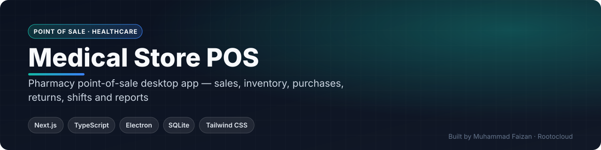
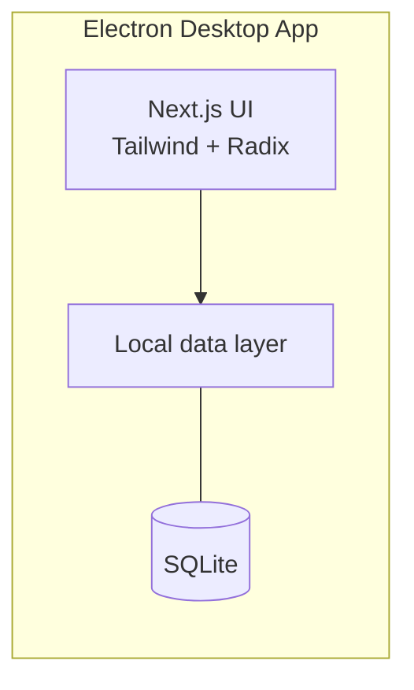

 

    

 

**[Request a live demo](https://rootocloud.com) · [Hire me](mailto:faizan.developer9200@gmail.com) · [More projects](https://github.com/MuhammadFaizan73)**

---

## 📌 Overview

A point-of-sale for pharmacies and medical stores, built with Next.js inside Electron so it runs as an offline desktop app backed by a local SQLite database.

## ✨ Key Features

### Sales
- Fast POS billing
- Returns handling
- Cashier shifts with opening and closing

### Stock
- Inventory management
- Purchases from suppliers
- Customer records

### Insights
- Sales and stock reports with charts
- Configurable store settings

## 🏗️ Architecture

## 🧰 Tech Stack

| Layer | Technology |
|---|---|
| **Framework** | Next.js · TypeScript |
| **Desktop** | Electron |
| **UI** | Tailwind CSS · Radix UI · lucide-react |
| **State** | Zustand |
| **Database** | SQLite (better-sqlite3) |
| **Charts** | Recharts |

<!-- SCREENSHOTS -->
<!-- /SCREENSHOTS -->

## 🔒 About the Source Code

This is a **commercial / client project**, so the source code is kept in a private repository.
This page documents what the system does and how it is built.

- 🎥 **Live walkthrough** — available on request
- 💼 **Want something similar for your business?** I build custom versions of this for clients.

## 👨‍💻 Author

**Muhammad Faizan** — Founder, [Rootocloud](https://rootocloud.com)
AI agents & automation · Web & mobile apps · Custom software

© Muhammad Faizan. All rights reserved.

